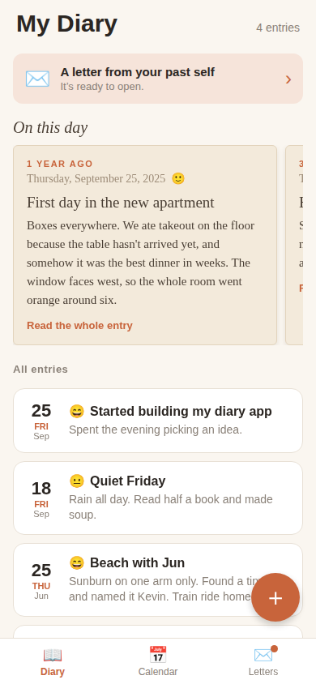
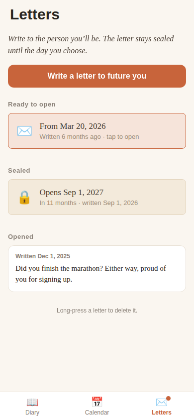
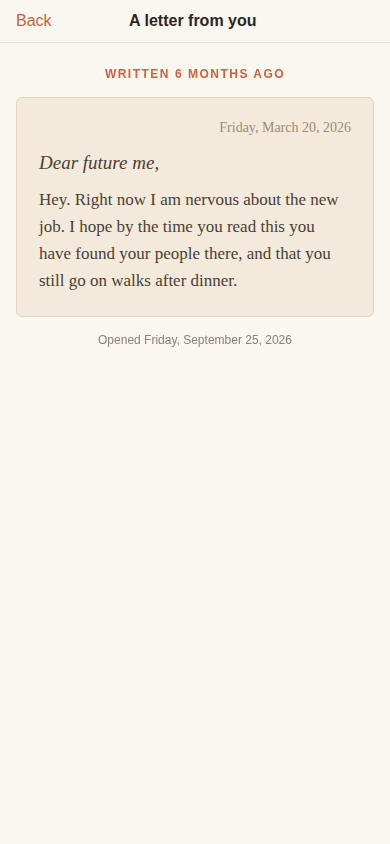
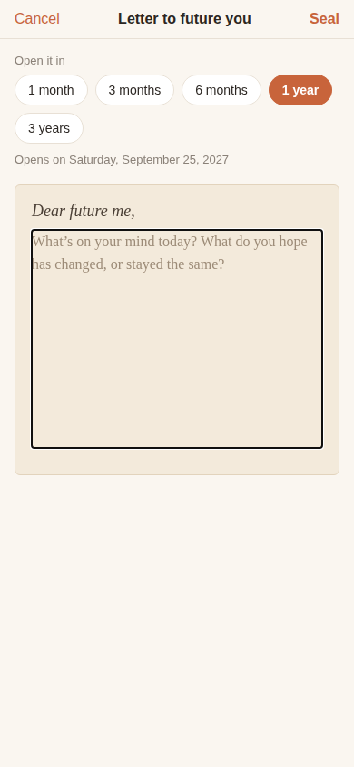
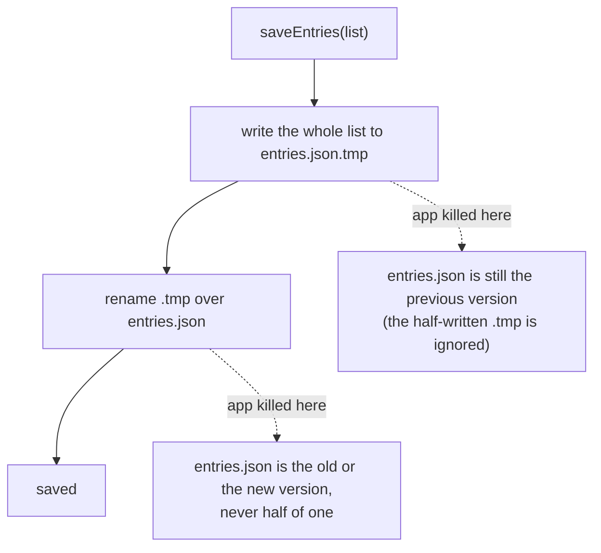
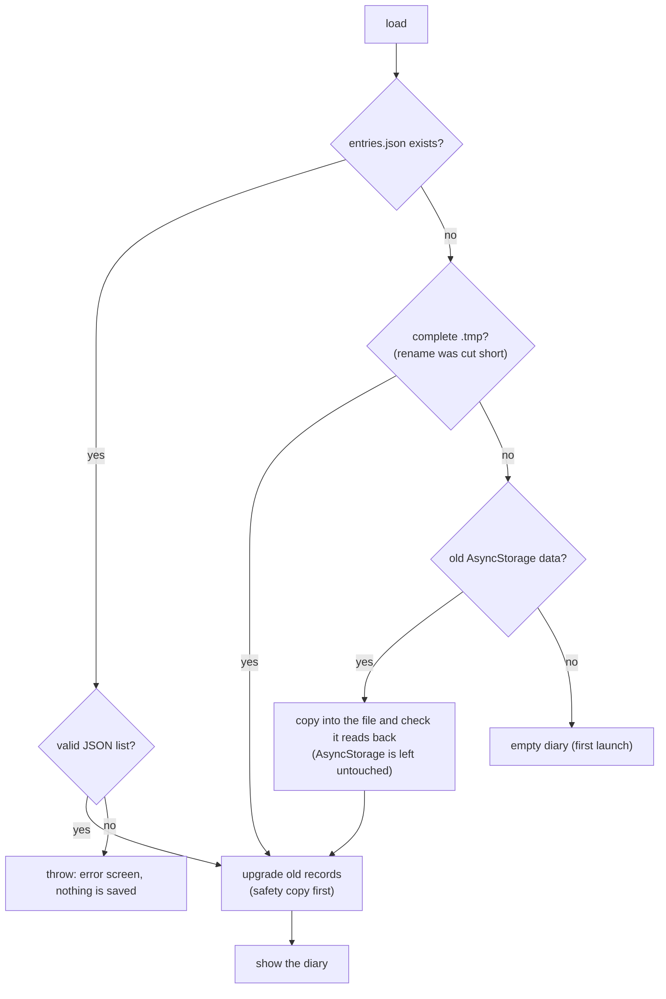
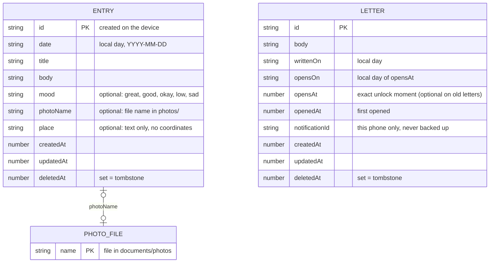

# My Diary

[](https://github.com/werfriend808/diary-app/actions/workflows/ci.yml)

**An offline-first diary app for iOS and Android that gives your memories back to you.**

Write about your day, as long or as short as you like. Over time the app shows you what you wrote
a week, a month, or a year ago, and lets you send letters to your future self that stay sealed
until the day you choose. Everything stays on your phone: no account, no ads, no network calls.

<p>
  
  
  
  
</p>

<!-- TODO(screenshots): add these files, then remove this comment.
<p>
  
  
  
</p>
<p></p>
-->

<sub>Screenshots use sample entries.</sub>

## Features

**Write**
- Entries with a title, full-length text, date, mood (😄 🙂 😐 😔 😢), an optional photo, and an
  optional place name ("Use current location" turns one position fix into a neighbourhood name;
  coordinates are never saved)
- A calendar with a mood-colored dot on each day you wrote

**Look back**
- **On this day:** entries from one week ago, the same day in earlier months, and this date in
  earlier years (Feb 29 entries come back on Feb 28 in other years)
- **Letters to future you:** seal a letter for 1 week to 3 years (opens at 9 AM that day) or a
  custom date and time. A local notification opens it when it's ready.

**Keep it safe**
- **App lock:** Face ID, fingerprint, or the phone's passcode; locks again after a minute away
- **Backup and restore:** entries, photos, and letters in one JSON file. Restoring only adds;
  it never deletes or changes what's already on the phone.
- **Crash-safe storage:** every save is atomic, and a damaged file is never overwritten (see
  [Architecture](#architecture))
- Dark mode, English and Korean

## Tech stack

| | |
|---|---|
| App | [Expo](https://expo.dev) SDK 57, React Native 0.86, React 19, TypeScript (strict) |
| Storage | JSON files via `expo-file-system` (entries, letters, photos), AsyncStorage (settings) |
| Device APIs | `expo-local-authentication`, `expo-notifications`, `expo-location`, `expo-image-picker`, `expo-sharing`, `expo-document-picker` |
| i18n | `i18next` / `react-i18next`, `expo-localization` |
| Quality | Jest + `jest-expo`, ESLint (`eslint-config-expo`), `tsc --noEmit`, GitHub Actions |
| Release | EAS Build (see [docs/RELEASE.md](docs/RELEASE.md)) |

## Getting started

You need [Node.js](https://nodejs.org) 22 LTS and, to try it on a phone, the free **Expo Go** app.

```bash
git clone https://github.com/werfriend808/diary-app.git
cd diary-app
npm install
npx expo start
```

Scan the QR code with Expo Go (Android) or the Camera app (iPhone). Phone and computer must be on
the same Wi-Fi; otherwise use `npx expo start --tunnel`.

Expo Go limits (everything works in a real build): Face ID falls back to the passcode on iPhone,
and Android Expo Go has no notifications, so sealed letters unlock in the app without one. In
development the letter composer also offers a **1 minute (dev)** period for trying notifications.

## Tests

```bash
npm test                  # all unit tests
npm run test:coverage     # with a coverage report (coverage/lcov-report/index.html)
npm run test:timezones    # date tests again in 6 time zones (UTC-11 to UTC+14)
npm run lint
npm run typecheck
```

CI runs all of these on every push and pull request.

What's tested (**201 tests**, 10 suites; 98% line / 91% branch coverage of the logic modules in
`src/*.ts`; screens are checked by hand):

- **Storage:** temp-file write then atomic rename; a crash while writing or before the rename
  leaves the previous diary intact; recovery from an interrupted rename; damaged files throw
  instead of being replaced by an empty diary; AsyncStorage → file migration; record upgrades
- **Backup:** format round trip, older/newer version handling, additive-only and idempotent
  merge, restoring deleted items, field-by-field validation of untrusted files
- **Dates:** local-day keys around midnight and DST, leap years, month-end clamping, "On this
  day", letter unlock times, the mood calendar grid
- **Notifications, settings, lock, place lookup:** scheduling limits, permission flow,
  fail-closed settings, never locking the owner out

File system and native modules are mocked (`test/mocks/`): an in-memory `expo-file-system` with
hooks that simulate the app being killed mid-write or mid-rename.

## Architecture

```
App.tsx                 State owner: loads once, passes live records to screens, saves on change
src/storage.ts          Atomic JSON file storage, recovery, migrations, photo files
src/backup.ts           Backup export (streamed) and validated, additive import
src/records.ts          Tombstones (soft delete)
src/memories.ts         Which old entries to bring back today
src/letters.ts          When a letter opens; sealing periods
src/notifications.ts    Local notifications for letters (serialized sync)
src/calendar.ts         Mood calendar grid and per-day mood
src/dates.ts            Local-calendar date math and wording
src/screens/, src/components/   UI
```

### Storage: why atomic rename

Entries and letters are each one JSON file in the app's documents folder (`data/entries.json`,
`data/letters.json`). A phone can kill an app at any moment, and writing a file in place can leave
half a JSON document behind, which would lose the whole diary. So every save writes the full list to
`entries.json.tmp` first and then **renames it over** `entries.json`. A rename within one folder is
atomic on the file system: the real file is either the old version or the new one, never half of
one. If the platform ever implements the move as delete-then-rename, the complete `.tmp` file is
still there, and loading recovers from it.

The second rule is **fail-safe loading**: only "nothing saved yet" becomes an empty list. If the
file exists but can't be read or parsed, loading throws and the app shows a "couldn't open your
diary" screen with a retry button. Falling back to `[]` would let the next save overwrite the
diary with nothing.





Entries moved from AsyncStorage to files because Android caps AsyncStorage at 6 MB, which years of
writing can reach. When an upgrade changes stored records (v2: photo file names instead of full
paths), the list exactly as stored is first copied to `entries.before-v2.json`, once, so the
conversion can always be undone.

### Backup format and versioning

A backup is one JSON file: `{ app: "my-diary", version: 1, exportedAt, entries, letters }`, with
each entry's photo embedded as base64 next to its file name. It is written one entry at a time so a
diary with many photos never has to fit in memory as one string.

- **Additive changes keep the version.** Fields added since v1 (`photoName`, `place`, letters'
  `updatedAt` and `opensAt`) are optional: older apps ignore them and newer apps fill in defaults
  when they're missing (`updatedAt` falls back to `createdAt`, letters without `opensAt` open at
  9 AM on `opensOn`).
- **Breaking changes bump the version.** An app refuses a file with a higher version than it knows
  ("update the app first") instead of half-reading it, and rejects a file whose version is missing
  or not a whole number.
- **Imports are untrusted.** Every item is rebuilt field by field: malformed items are skipped and
  counted, unknown fields are dropped, and photo names are checked so they can't point outside the
  photos folder.
- **Restore is additive and idempotent.** Items whose id already exists are kept as they are, so
  importing the same file twice changes nothing. The one exception is an item deleted on this
  phone: restoring brings it back, with `updatedAt` set to now.

### Data model, ready for sync

The app has no server yet, but the data is shaped so one can be added without a migration:

- **Stable ids** created on the device, so records can be merged from several phones
- **`createdAt` / `updatedAt`** on every record, so a sync can pick the newer version
- **Tombstones:** deleting keeps an emptied record with `deletedAt`, so a sync can tell "deleted
  here" from "not uploaded yet"; screens only ever see live records
- **Photo file names, not paths:** a `file://` path changes on another phone or after a reinstall
- **Local calendar days** (`YYYY-MM-DD`) for an entry's date, and an exact timestamp only where a
  moment matters (a letter's `opensAt`)



More on the trade-offs behind these choices: [docs/DESIGN_NOTES.md](docs/DESIGN_NOTES.md).

## Project layout

```
App.tsx                     Tabs, overlays, load/save, lock, notification wiring
src/
  screens/                  Diary list, calendar, editor, letters, composer, reader, settings, lock
  components/               "On this day" cards, entry rows
  storage.ts  backup.ts  records.ts  memories.ts  letters.ts  notifications.ts
  calendar.ts  dates.ts  lock.ts  location.ts  placeName.ts  settings.ts  theme.tsx  types.ts
  i18n/                     en.json, ko.json and set-up
  __tests__/                Unit tests
test/                       Jest set-up, mocks, test data factories, time-zone runner
locales/                    Korean/English iOS permission prompts
docs/                       Design notes, release guide, privacy policy draft, screenshots
.github/workflows/ci.yml    CI
```

## Future work

v1.0 is feature-complete; these are ideas for later, deliberately left out of v1.0:

- **Optional cloud sync** (account + server): last-writer-wins per record using `updatedAt` and
  tombstones, photos uploaded separately by file name
- **Encrypted backups** (the backup file is currently plain JSON)
- **Faster backups for large photo libraries:** a zip with photo files instead of base64 in one
  JSON file, and a streaming import
- Search, monthly and yearly recaps, a "same day across the years" view
- Component tests for the screens (React Native Testing Library) and an end-to-end smoke test
- App Store / Google Play release (final name, icon, published privacy policy)

## License

[MIT](LICENSE)
