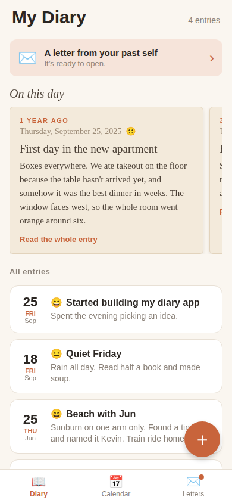
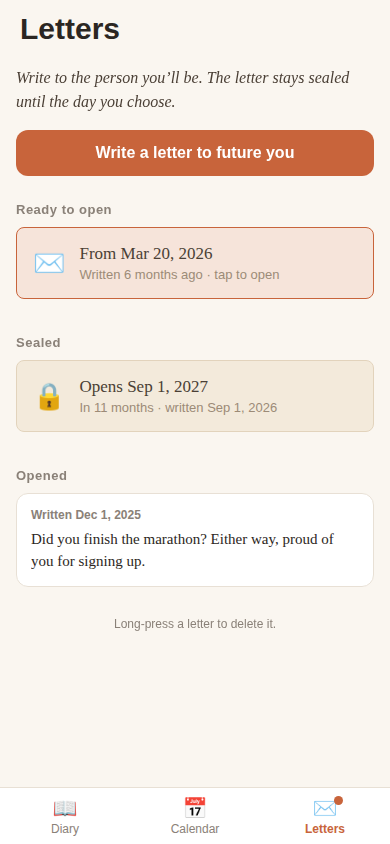
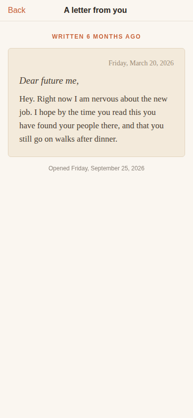
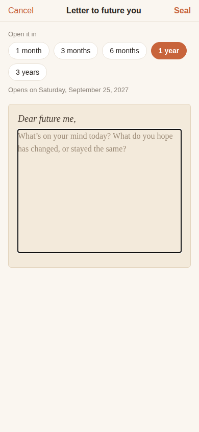

# My Diary

**A private diary that gives your memories back to you.**

Write about your day, as long or as short as you like. Over time the app starts showing you
what you wrote a week, a month, or a year ago, and lets you send letters to your future self
that stay sealed until the day you choose.

Everything stays on your phone. No account, no ads, no internet needed.

<p>
  
  
  
  
</p>

<sub>Screenshots use sample entries.</sub>

## Features

### Write
- Diary entries with a title, text, date, and an optional photo
- A mood for each day (😄 🙂 😐 😔 😢)
- A calendar with a mood-colored dot on each day you wrote

### Look back
- **On this day:** the top of the Diary tab brings back entries from one week ago, the same
  day in earlier months, and this date in earlier years. They appear as paper-style cards you
  swipe through.
- **Letters to future you:** write a letter and seal it for 1 month, 3 months, 6 months,
  1 year, or 3 years. You can't read it until then. On the morning it unlocks you get a
  notification, and a banner and a dot on the Letters tab let you know.

### Keep it safe
- **App lock:** Face ID, fingerprint, or your phone's passcode when the app opens (and again
  after a minute in the background)
- **Backup and restore:** save entries, photos, and letters to one file (Files, Google Drive,
  email…), and restore it on a new phone. Restoring only adds; it never deletes.
- **Dark mode:** follows your phone, or choose Light or Dark in Settings

## Tech

- [Expo](https://expo.dev) SDK 57 / React Native, TypeScript
- Entries, letters, and settings are stored on the device with AsyncStorage; photos are copied
  into the app's private documents folder (`expo-file-system`)
- `expo-local-authentication` (app lock), `expo-notifications` (local letter reminders),
  `expo-sharing` + `expo-document-picker` (backup and restore)
- No backend, no analytics, no network calls
- Privacy policy draft: [`docs/privacy-policy.md`](docs/privacy-policy.md)

## How this app gets to users

This is a real native app for iPhone and Android. Users download it from the **App Store**
and **Google Play** like any other app.

It's built with **Expo**, a framework for React Native apps. There are two separate steps,
and they use different tools:

| | Who it's for | Tool |
|---|---|---|
| **Testing while developing** | Only you | Expo Go (a free testing app) |
| **Releasing to the stores** | Your users | EAS Build + EAS Submit |

Users never see or install Expo Go. It's just a quick way to preview changes on your own
phone without building the app each time.

## Test during development

You need [Node.js](https://nodejs.org) (LTS) on your computer and the free **Expo Go** app
on your phone.

```bash
npm install
npx expo start
```

Scan the QR code: with Expo Go on Android, or with the Camera app on iPhone. Your phone and
computer must be on the same Wi-Fi. If it won't connect, use `npx expo start --tunnel`.

Expo Go limits to know about (everything works in the real store build):
- On iPhone, Face ID doesn't work inside Expo Go, so the app lock falls back to your passcode.
- On Android, Expo Go doesn't support notifications, so sealed letters don't send a
  "ready to open" notification. The letter still unlocks in the app.

Type check before committing:

```bash
npx tsc --noEmit
```

## Release to the stores

The store versions are built in the cloud with **EAS Build**, so you don't need a Mac,
Xcode, or Android Studio.

What you need first:
- A free [Expo account](https://expo.dev/signup)
- An [Apple Developer Program](https://developer.apple.com/programs/) membership for iPhone
- A [Google Play Console](https://play.google.com/console) account for Android. New personal
  accounts must run a closed test with at least 12 testers for 14 days before a public release.

Steps:

```bash
# 1. Log in and set up the build config (creates eas.json; run once)
npx eas-cli@latest login
npx eas-cli@latest build:configure

# 2. Build the store versions (Android .aab, iPhone .ipa)
npx eas-cli@latest build --platform android --profile production
npx eas-cli@latest build --platform ios --profile production

# 3. Upload the builds to Google Play / App Store Connect
npx eas-cli@latest submit --platform android
npx eas-cli@latest submit --platform ios
```

After uploading, you finish the store listing (screenshots, description, privacy details)
in Google Play Console and App Store Connect, then submit for review.

Before the first release, `app.json` still needs the final app name, icon, splash screen,
and permanent app IDs (`ios.bundleIdentifier` and `android.package`, e.g.
`com.yourname.appname`). The app IDs can never change after publishing.

## Project layout

```
App.tsx                           Tabs, the + button, and which screen is showing
src/
  screens/
    EntryListScreen.tsx           Diary tab: memories on top, then all entries
    CalendarScreen.tsx            Month grid with mood dots and that day's entries
    EditorScreen.tsx              Write, edit, or delete an entry
    LettersScreen.tsx             Ready, sealed, and opened letters
    LetterComposerScreen.tsx      Write and seal a letter
    LetterReaderScreen.tsx        Read an opened letter
    SettingsScreen.tsx            Appearance, app lock, backup and restore
    LockScreen.tsx                Shown while the diary is locked
  components/
    MemoriesSection.tsx           "On this day" cards and the ready-letter banner
    EntryCard.tsx                 One entry row in a list
  memories.ts                     Picks which old entries to bring back today
  storage.ts                      Saving entries, letters, and photos
  backup.ts                       Backup file export and import
  lock.ts                         Face ID / fingerprint / passcode
  notifications.ts                "Your letter is ready" notifications
  settings.ts                     Saved settings
  dates.ts                        Date helpers
  theme.tsx                       Light and dark colors, fonts, and moods
  types.ts                        Entry and Letter types
docs/
  privacy-policy.md               Draft privacy policy (needed for the stores)
  name-ideas.md                   Shortlist of app names
```

## Roadmap

Before launch
- [ ] Final app name, icon, and splash screen
- [x] Backup and restore, so a lost phone doesn't mean a lost diary
- [x] App lock with Face ID, fingerprint, or passcode
- [x] Notification when a letter unlocks
- [x] Dark mode
- [ ] Privacy policy: fill in the draft and publish it at a public URL
- [ ] Test everything on a real iPhone and Android phone
- [ ] Permanent app IDs in `app.json`
- [ ] App Store and Google Play release (EAS Build, see above)

Later
- [ ] Monthly and yearly recaps
- [ ] "Same day across the years" view
- [ ] Search
- [ ] Optional cloud sync
